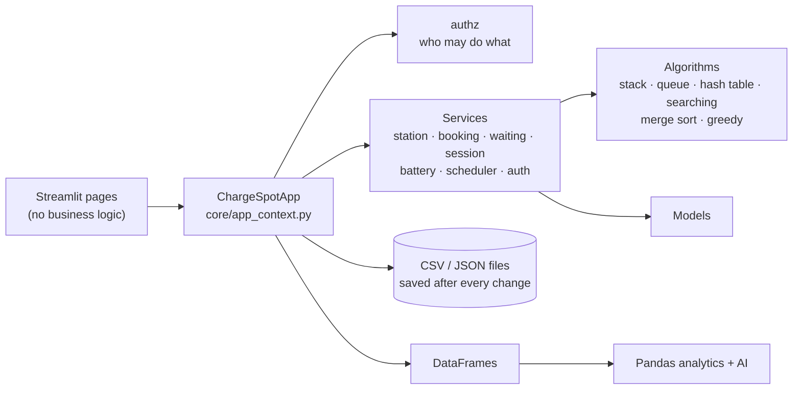
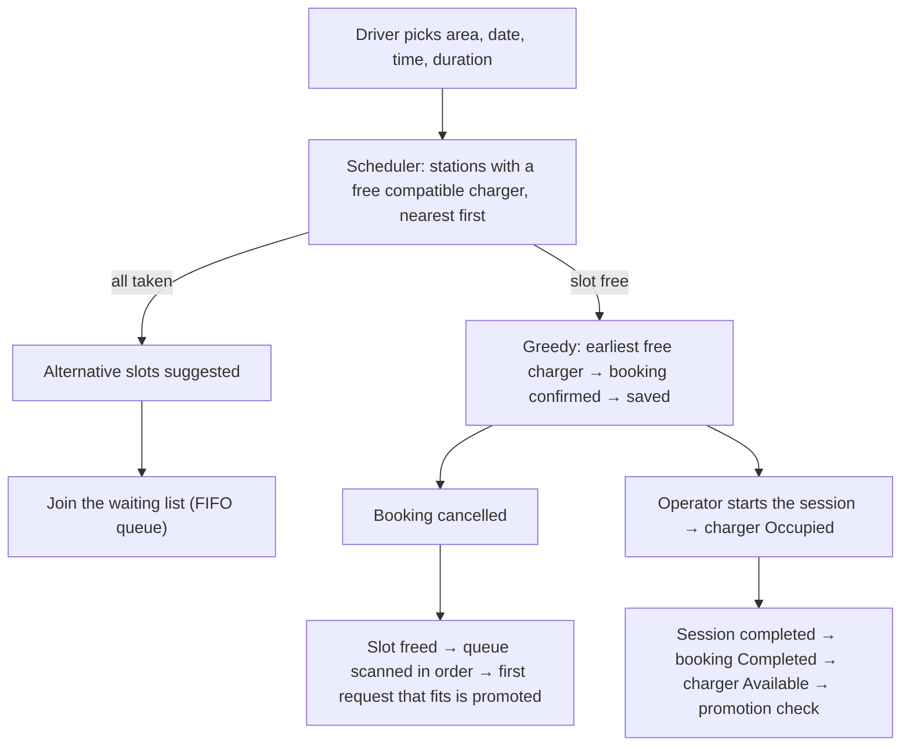

<div align="center">

# ⚡ ChargeSpot

**Find , book and manage EV charging - with a fair waiting list, live sessions and an analytics dashboard.**

![Python]\([https://img.shields.io/badge/python-3.12-3776AB?logo=python&logoColor=white](https://img.shields.io/badge/python-3.12-3776AB?logo=python&logoColor=white))
![Streamlit]\([https://img.shields.io/badge/streamlit-1.65-FF4B4B?logo=streamlit&logoColor=white](https://img.shields.io/badge/streamlit-1.65-FF4B4B?logo=streamlit&logoColor=white))
![Pandas]\([https://img.shields.io/badge/pandas-analytics-150458?logo=pandas&logoColor=white](https://img.shields.io/badge/pandas-analytics-150458?logo=pandas&logoColor=white))
![Data]\([https://img.shields.io/badge/data-100%25%20simulated-orange](https://img.shields.io/badge/data-100%25%20simulated-orange))
![Program]\([https://img.shields.io/badge/Samsung%20Innovation%20Campus-SIC%208-1428A0](https://img.shields.io/badge/Samsung%20Innovation%20Campus-SIC%208-1428A0))

_Graduation project - SIC 8 Coding and Programming_

</div>

---

## 📖 What is ChargeSpot?

EV drivers arrive at a station and find every charger busy. Operators juggle bookings by hand. Managers cannot see which
stations are overloaded and which sit idle.

ChargeSpot is a **Streamlit application** that solves this for a network of **16 stations and 56 chargers** (Cairo and
Alexandria): drivers reserve a _compatible_ charger without double-booking, queue fairly when everything is taken, operators
run the charging sessions, and administrators study demand, utilization and cancellations.

> ⚠️ **All data is simulated.** No real chargers, vehicles or people are connected. Station coordinates are approximate and
> used only for the map.

## ✨ Highlights

|                            |                                                                                                                                |
| -------------------------- | ------------------------------------------------------------------------------------------------------------------------------ |
| 🔌 **Stations & chargers** | AC / DC chargers, three connector types, status, search and filters, add / edit / remove with **Undo**                         |
| 📅 **Smart booking**       | no overlaps _per charger_, connector compatibility, opening hours, nearest-available-station greedy choice, alternative slots  |
| ⏳ **Fair waiting list**   | FIFO queue with live positions; a freed slot goes automatically to the driver who has waited longest                           |
| 🔋 **Charging sessions**   | planned vs actual time, simulated energy, charger status follows the session, history sorted by our own Merge Sort             |
| 🚗 **Driver dashboard**    | bookings, queue position, session history, **battery monitor** (range and charging-time _estimates_)                           |
| 📊 **Admin analytics**     | cleaning report, KPIs, generated insights, demand heatmap, station map, 15+ charts, CSV export                                 |
| 🤖 **AI features**         | demand forecast, rule-based assistant (English / Arabic), station recommendation, scheduling optimizer, predictive maintenance |
| 🔐 **Accounts & roles**    | login, e-mail verification, password reset, three roles, permissions enforced in the application layer                         |


## 🚀 Quick start

```bash
python -m venv .venv
source .venv/bin/activate            # Windows: .venv\Scripts\activate
pip install -r requirements.txt
streamlit run app.py
```

The simulated history ships in `data/`. If you delete `data/*.csv` it is regenerated on the next start (about 30 s).

**Demo accounts** (fake people, already verified):

| Role                | E-mail                    | Password       |
| ------------------- | ------------------------- | -------------- |
| 🛠️ Administrator    | `admin@chargespot.com`    | `Admin1234`    |
| 🔧 Station Operator | `operator@chargespot.com` | `Operator1234` |
| 🚗 Driver           | `ahmed@gmail.com`         | `123456789`    |

### Trying registration without a mail server

New accounts must verify their e-mail address before the first login. With no mail server configured the messages are only
written to `data/outbox/`, so a new user could never log in. For a demo, show the "mailbox" on the login screen instead:

```bash
CHARGESPOT_DEV_MAILBOX=1 streamlit run app.py          # Windows PowerShell:  Env: Chargespot Dev Mailbox=1; streamlit run app.py
```

Register, copy the code from the _Development mailbox_ box, paste it in **Verify e-mail**, then log in.
**Never use this setting on a public server**: it shows everybody's reset codes. See [Configuration](#️-configuration).

## 👥 Roles and permissions

Defined once in `models/user.py` (`permissions()`); the menu and every page read the same table (`services/authz.py`).

| Permission                                                                                                     | 🚗 Driver | 🔧 Operator | 🛠️ Admin |
| -------------------------------------------------------------------------------------------------------------- | :-------: | :---------: | :------: |
| Book, cancel own booking, join waiting list, battery monitor                                                   |    ✅     |             |          |
| Smart recommendation                                                                                           |    ✅     |     ✅      |    ✅    |
| View stations                                                                                                  |    ✅     |     ✅      |    ✅    |
| Start / complete sessions, set charger status, manage the waiting list, see all bookings                       |           |     ✅      |    ✅    |
| Add / edit / remove stations and chargers, Undo, cancel any booking, view any driver, analytics, Algorithm Lab |           |             |    ✅    |

## 🧩 How it works



**A booking, end to end**



State: `st.cache_resource` holds **one shared app** per server process (every change is written to CSV/JSON at once, so it
survives a restart); `st.session_state` holds who is logged in in this browser tab.

## 🗂️ Project structure

```
app.py                  login / register / verify / reset + role-based navigation
models/                 Station, Charger (AC/DC), Booking, ChargingSession, User roles, exceptions
algorithms/             stack, queue, hash_table, sorting (merge sort), searching, interval_utils, greedy_scheduler
services/               station, booking, waiting, scheduler, session, battery,
                        auth, authz, token_service, login_session_service, mailer
utils/                  validators (regex), storage (atomic JSON)
core/                   app_context (wires everything), state, browser_session, schema, data_store, ui
analytics/  ai/         Pandas cleaning, metrics, charts, insights · forecast, recommendation, optimizer, maintenance
pages/                  the 9 Streamlit pages
data/                   stations.json, distances.json, simulated history, generator, catalog builder
tests/                  325 automated tests
docs/                   audit, changes, checklist, algorithms, schema, auth, demo script
legacy/                 the team's original files, untouched (for comparison)
```

## 🧠 Data structures and algorithms

All written by the team (no built-in sort or search in the required parts). Full explanations in
[`docs/ALGORITHMS.md`](docs/ALGORITHMS.md); the **Algorithm Lab** page measures them live.

| Structure / algorithm     | Used for                                                      | Measured on the real data                                               |
| ------------------------- | ------------------------------------------------------------- | ----------------------------------------------------------------------- |
| **Stack**                 | undo of every administrator change                            | LIFO, O(1)                                                              |
| **Queue** (FIFO)          | waiting list, positions, promotion                            | O(1) enqueue / dequeue                                                  |
| **Hash table** (chaining) | ID registries of stations, chargers, bookings                 | finding booking #28 255: **1** comparison                               |
| **Binary search**         | overlap check on a charger's sorted busy list; booking lookup | same lookup: **13** comparisons (sequential: 28 255)                    |
| **Sequential search**     | station-name search (unsorted)                                | O(n)                                                                    |
| **Merge Sort**            | session history, booking lists                                | 2 000 items: **19 452** comparisons (bubble sort: 1 998 769)            |
| **Greedy**                | earliest free slot on the best compatible charger             | counter-example in the app: 270 min of waiting vs 90 for the best order |

Overlap rule (from the project plan): two bookings conflict if `A.start < B.end and B.start < A.end`; back-to-back is allowed.

## 📊 Analytics and AI (administrator)

- **Cleaning** with a defect report: a messy file with 11 injected defect types, every one detected exactly.
- **KPIs and insights generated from the data** (nothing hard-coded), demand heatmap and trend, station map, CSV export;
    upload your own bookings CSV and the dashboard works on it.
- **Demand forecast** compared with two baselines on a hold-out period (no leakage).
- **Assistant** answering from computed numbers only (English / Arabic). Optional LLM rewording: off by default, and any
    rewrite whose numbers differ from the computed answer is rejected.
- **Smart recommendation**, **scheduling optimizer** (FCFS vs heuristics vs local search vs exact backtracking),
    **predictive maintenance** (flags chargers that are getting worse compared with themselves).

> The data is synthetic, so forecast and maintenance results show that the _method_ works, not real-world accuracy.
> The optimizer is an offline analysis (it assumes all requests are known), so its 12-32 % saving is an upper bound.

## 🔐 Authentication and security

- Passwords: salted PBKDF2-SHA256 (100 000 iterations); one error message for "wrong password" and "unknown e-mail".
- **E-mail verification** and **forgot password**: single-use tokens stored only as SHA-256 hashes (24 h / 30 min); at most
    3 reset e-mails per address per hour; a password reset logs the account out everywhere.
- **Login survives a refresh**: random opaque token in a cookie, validated by the server on every run
    (idle timeout 2 h, absolute 12 h; logout and reset take effect immediately).
- **Authorization is enforced in the application layer**: every state-changing method of `ChargeSpotApp` takes the acting
    user and checks the permission first, so the rules hold for any caller, not only for pages.

Details: [`docs/AUTH.md`](docs/AUTH.md).

**Known security gaps (found in review, not fixed yet)** - fix these before any public deployment:

| Gap                                                                        | Why it matters                                                                                 |
| -------------------------------------------------------------------------- | ---------------------------------------------------------------------------------------------- |
| No limit on failed logins                                                  | passwords can be guessed without delay                                                         |
| An unknown e-mail answers faster (≈0 ms) than a known one (≈100 ms)        | lets an attacker list registered e-mails                                                       |
| An unverified account can be created for **someone else's** address        | if the owner then clicks the verification link, the creator's password works ("pre-hijacking") |
| SMTP connections do not verify the server certificate                      | credentials and reset links could be intercepted                                               |
| National ID and phone are stored unencrypted in `users.json` (git-ignored) | personal data at rest                                                                          |
| The session cookie is set by JavaScript (not `HttpOnly`)                   | readable by scripts on the page                                                                |
| Demo credentials are shown on the login screen                             | remove before deployment                                                                       |

## ⚙️ Configuration

Everything is optional; defaults work for a local demo.

| Variable                                                                       | Meaning                                                       |
| ------------------------------------------------------------------------------ | ------------------------------------------------------------- |
| `CHARGESPOT_DATA_DIR`                                                          | use another data folder                                       |
| `CHARGESPOT_SMTP_HOST`, `_PORT` (587 STARTTLS / 465 SSL), `_USER`, `_PASSWORD` | real e-mail (Gmail: use an _app password_)                    |
| `CHARGESPOT_MAIL_FROM`, `CHARGESPOT_BASE_URL`                                  | sender address; public URL used in e-mail links               |
| `CHARGESPOT_DEV_MAILBOX=1`                                                     | no SMTP: show the e-mails on the login screen (**demo only**) |
| `ANTHROPIC_API_KEY`, `CHARGESPOT_LLM_MODEL`                                    | optional LLM rewording of the assistant's answers             |

Secrets go in the environment or in `.streamlit/secrets.toml` (git-ignored). Never commit them.

## 🧪 Testing

```bash
python -m pytest            # 325 tests, about 1.5 minutes
```

| Area                                                                         | Tests                 |
| ---------------------------------------------------------------------------- | --------------------- |
| Data structures and algorithms                                               | 34                    |
| Services (booking, waiting, scheduler, stations, sessions, battery, auth)    | 53                    |
| End-to-end flows with files on disk and restarts                             | 19                    |
| E-mail verification and login sessions / authorization                       | 20 / 23               |
| Streamlit pages with real logins / full user journeys                        | 45 / 6                |
| Pandas cleaning, metrics, generator                                          | 15 / 10 / 9           |
| AI: forecast, assistant, recommendation, optimizer, maintenance, LLM wording | 5 / 20 / 22 / 20 / 16 |
| Search experiment                                                            | 8                     |

The page tests check **behaviour and structure**, not how the pages look: open every page yourself before a demo.

## 🗃️ Data

120 days of **simulated history** (to 2026-10-13): ~28 000 bookings, ~22 600 sessions, 300 drivers, 9 vehicle models, with
rush-hour peaks, a different Friday / Saturday pattern, popular and quiet stations, shifted / queued / cancelled / no-show
bookings. Every booking made in the app is added to the same files. The station catalog merges the team's two original
catalogs; **chargers, prices and coordinates for stations 2-16 were added by the integrator** (the original data had chargers
for one station only). Formats: [`docs/SCHEMA.md`](docs/SCHEMA.md).

## 👨‍💻 Team

| Member   | Owns                                                                 |
| -------- | -------------------------------------------------------------------- |
| Member 1 | stations, chargers, hash table, stack, sequential search, validation |
| Member 2 | bookings, waiting list, queue, greedy scheduling, binary search      |
| Member 3 | charging sessions, battery monitor, Merge Sort, exceptions           |
| Member 4 | data, analytics, AI features, integration, authentication            |

_(Replace "Member N" with your names.)_ Who changed what in the integration: [`docs/TEAM_CHANGES.md`](docs/TEAM_CHANGES.md).

## 📚 Documentation

| File                                                                       | Content                                                             |
| -------------------------------------------------------------------------- | ------------------------------------------------------------------- |
| [`docs/REQUIREMENTS_CHECKLIST.md`](docs/REQUIREMENTS_CHECKLIST.md)         | every SIC 8 requirement → where it is → the test that proves it     |
| [`docs/ALGORITHMS.md`](docs/ALGORITHMS.md)                                 | purpose, input, output, workflow, complexity, limits, justification |
| [`docs/TEAM_AUDIT.md`](docs/TEAM_AUDIT.md)                                 | what was wrong in the first version, with evidence                  |
| [`docs/TEAM_CHANGES.md`](docs/TEAM_CHANGES.md)                             | what changed per member and what each must be able to explain       |
| [`docs/AUTH.md`](docs/AUTH.md)                                             | roles, sessions, verification, password reset, e-mail setup         |
| [`docs/SCHEMA.md`](docs/SCHEMA.md)                                         | IDs, formats, files                                                 |
| [`docs/EDGE_CASE_TESTING_NOTES.md`](docs/EDGE_CASE_TESTING_NOTES.md)       | edge cases and the tests that cover them                            |
| [`docs/DEMO_SCRIPT_AND_DEFENSE_QA.md`](docs/DEMO_SCRIPT_AND_DEFENSE_QA.md) | 8-10 minute demo flow and likely questions                          |
| [`docs/AI_USE_LOG_Member4.md`](docs/AI_USE_LOG_Member4.md)                 | AI-use log (each member must complete their columns)                |

## ⚠️ Known limitations

- One server process shares one app object: fine for a demo, not for several servers.
- A vehicle is "compatible" with a charger when their connector types are equal; all stations are open 24 h; times have no time zone.
- The cookie helper uses `st.components.v1.html`, which Streamlit has announced it will remove. Tested with Streamlit 1.65:
    keep that version (or migrate to `st.iframe`) before upgrading.
- Tested on Python 3.12 (pandas 3.0, scikit-learn 1.8, plotly 7.1).

---

<div align="center">

Built for the **Samsung Innovation Campus - SIC 8** graduation project. Educational use; all data is simulated.

</div>
